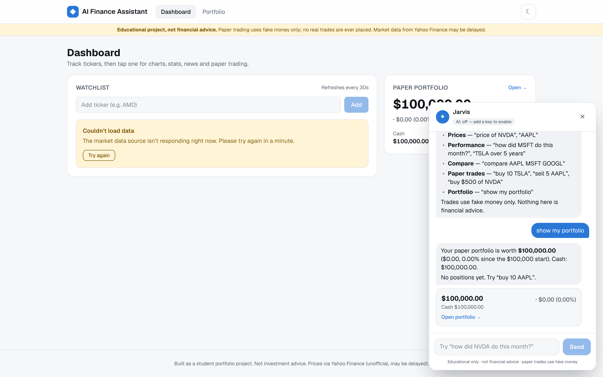
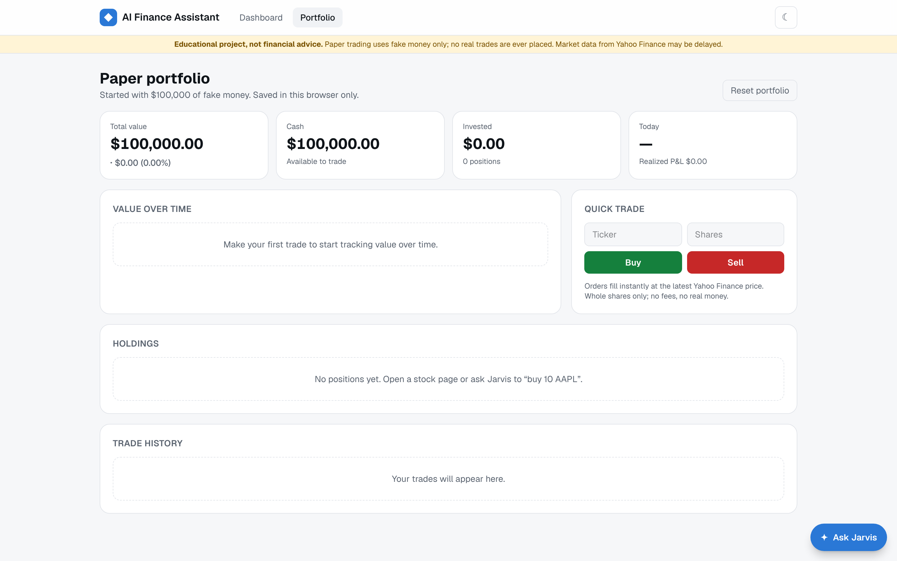
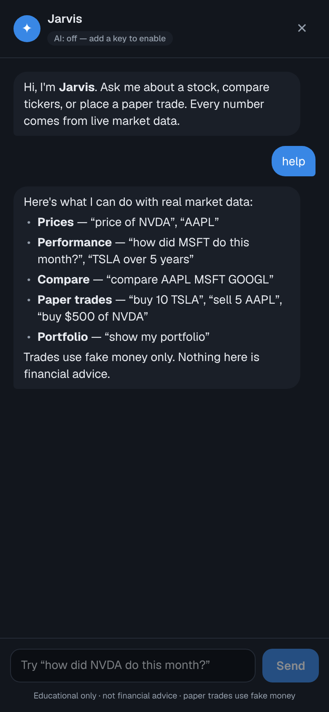
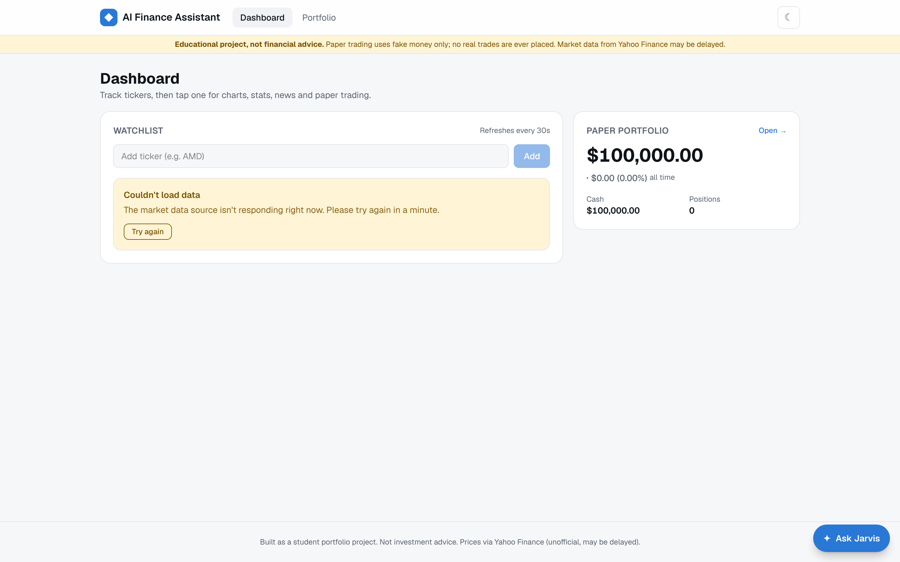

# AI Finance Assistant

A Jarvis-style chat assistant for stock research plus a **paper-trading** portfolio. Ask "how did NVDA do this month?", compare tickers, or "buy 10 TSLA" with fake money. Every number comes from real market data.

> ⚠️ **Educational project, not financial advice.** Paper trading uses fake money only. The app never places real trades. Market data comes from Yahoo Finance through an unofficial library and may be delayed.

Built with Next.js (App Router), TypeScript and Tailwind CSS. Runs with **no API keys**. Add an Anthropic key and the chat switches to Claude with tool use.

## Screenshots

| Jarvis chat (built-in command mode) | Paper portfolio |
| --- | --- |
|  |  |

| Mobile, dark mode | Graceful handling when the data source is down |
| --- | --- |
|  |  |

> **About these screenshots:** they were captured with Playwright in a sandbox that couldn't reach Yahoo Finance. The live-price views therefore show the app's real "data source unavailable" state rather than prices. To regenerate all of them with live data (watchlist sparklines, NVDA chart, a portfolio with sample paper trades, chat with charts), run the app and then `npm run screenshots`. See [Taking screenshots](#taking-screenshots).

## Features

- **Dashboard watchlist.** Live-ish prices that refresh every 30s, daily % change, and intraday sparklines. Add tickers (with search suggestions and validation against a real quote) and remove them. Saved in `localStorage`.
- **Stock detail pages** (`/stock/AAPL`). Price chart with 1D / 1W / 1M / 1Y / 5Y ranges and a hover tooltip, plus key stats (market cap, P/E, forward P/E, volume, and day and 52-week ranges) and recent news headlines.
- **Paper trading.** Start with $100,000 of fake cash. Buy and sell whole shares at the live price. The portfolio page shows holdings, average cost basis, unrealized and realized P&L, total value over time (rebuilt from your trade log and real historical prices), and a trade history. You can reset it at any time.
- **Jarvis chat**, on every page, with two modes:
  - **Basic mode (default, no key):** a built-in command parser understands things like `price of NVDA`, `how did MSFT do this month`, `compare AAPL MSFT`, `buy 10 TSLA`, `buy $500 of NVDA`, `sell 5 AAPL`, `show my portfolio` and `help`. Replies include quote cards, mini charts, comparison charts and trade confirmations.
  - **AI mode (optional):** when `ANTHROPIC_API_KEY` is set, Claude answers free-form questions. It calls the same six functions (`get_quote`, `get_history`, `compare`, `buy`, `sell`, `get_portfolio`) through tool use, so it can't make up prices.
- **Error handling.** Unknown tickers, invalid input and outages of the data source show friendly messages. If AI mode fails (bad key, rate limit, outage), the chat falls back to basic mode and tells you why.
- **Responsive, with dark mode.** It works on phones (the chat becomes full-screen) and has a light/dark toggle that doesn't flash on load.
- **Tested.** 80+ unit tests cover the trading engine, the command parser, the chat tools and the Claude tool-use loop. The Claude tests use a mocked client, so the real API is never called.

## Tech stack

| Area | Choice |
| --- | --- |
| Framework | [Next.js 16](https://nextjs.org) App Router, React 19, TypeScript |
| Styling | Tailwind CSS v4 with CSS-variable design tokens (light/dark) |
| Market data | [`yahoo-finance2`](https://github.com/gadicc/yahoo-finance2) (server-side only, no key) |
| Charts | [Recharts](https://recharts.org) for the main charts and a hand-written SVG sparkline |
| Client data fetching | [SWR](https://swr.vercel.app) (caching, polling, retry) |
| AI (optional) | [Anthropic TypeScript SDK](https://github.com/anthropics/anthropic-sdk-typescript), Claude with tool use |
| Validation | [Zod](https://zod.dev) for API request bodies and tool inputs |
| Tests | [Vitest](https://vitest.dev) |
| Screenshots | [Playwright](https://playwright.dev) |
| Hosting | Vercel (free Hobby tier) |

## Getting started

Requirements: **Node.js 22+** and npm.

```bash
git clone https://github.com/saitheguy-ops/ai-finance-assistant.git
```

```bash
cd ai-finance-assistant
```

```bash
npm install
```

```bash
npm run dev
```

Open http://localhost:3000. That's it: no keys or database are needed.

Other scripts:

| Command | What it does |
| --- | --- |
| `npm run lint` | ESLint (Next.js core-web-vitals and TypeScript rules) |
| `npm run typecheck` | Generates route types and runs `tsc --noEmit` |
| `npm test` | Runs the Vitest unit tests |
| `npm run build` | Production build |
| `npm run screenshots` | Captures README screenshots from a running app (see below) |

GitHub Actions runs lint, typecheck, tests and build on every push (`.github/workflows/ci.yml`).

## Enabling full AI chat (optional)

Without a key, Jarvis runs in basic mode and the chat header shows **"AI: off — add a key to enable"**. To switch to Claude you don't need to change any code.

**Locally**

1. Get an API key from the [Anthropic Console](https://console.anthropic.com/).
2. Copy the example env file:

   ```bash
   cp .env.example .env.local
   ```

3. Put your key after `ANTHROPIC_API_KEY=` in `.env.local`.
4. Restart `npm run dev`. The badge changes to **"AI: on"**.

**On Vercel**

1. Open your project, then **Settings → Environment Variables**.
2. Add `ANTHROPIC_API_KEY` with your key as the value, for the environments you want (Production, Preview).
3. Redeploy: **Deployments → ⋯ → Redeploy**. Environment variable changes only apply to new deployments.

**How the key is kept safe**

- The key is read in exactly one file, `src/lib/server/ai-config.ts`, which imports `server-only`. If any browser code ever imported it, the build would fail.
- `GET /api/ai-status` returns only `{ "enabled": true | false }`, never the key.
- `.env`, `.env.local` and all `.env*.local` files are git-ignored. Only `.env.example`, which has a blank key, is committed.

**Model and cost.** AI mode uses `claude-opus-5-5` by default. Set `ANTHROPIC_MODEL` to use a different model, for example a cheaper one, with no code change. The chat endpoint has a best-effort rate limit of 20 AI messages per IP every 10 minutes, so a public demo can't run up your bill.

## Deploying to Vercel

1. Push this repo to GitHub.
2. On [vercel.com/new](https://vercel.com/new), import the repository. Vercel detects Next.js automatically, so keep the default build settings.
3. Click **Deploy**. The app works immediately in basic mode.
4. Optionally, add `ANTHROPIC_API_KEY` as described above and redeploy.

Everything fits in the free Hobby tier: there's no database, and the chat route's `maxDuration` is 60 seconds, which is within Hobby limits.

## Taking screenshots

```bash
npm run dev
```

Then, in a second terminal:

```bash
npm run screenshots
```

The script (`scripts/screenshots.mjs`) uses a fresh Playwright browser profile. It places three sample paper trades (in that throwaway profile only), then saves images to `docs/screenshots/`: `dashboard.png`, `stock.png`, `portfolio.png`, `chat.png`, `mobile-dashboard.png` and `mobile-chat.png`. Add `stock.png` and `mobile-dashboard.png` to the tables above if you like. Options: `BASE_URL`, `CHAT_PROMPTS="msg1|msg2"`, `SKIP_TRADES=1`.

## Design decisions

Choices I made along the way, and why:

- **Portfolio in `localStorage`, not a database.** There's no sign-up and no server state, so it deploys for free. The trade-off is that your portfolio lives in one browser, and clearing site data resets it.
- **One set of tools for both chat modes.** The command parser and Claude call the same functions (`src/lib/chat/tools.ts`). Basic mode is the default and also the fallback when AI fails.
- **Trades in chat run on the server, then replay in the browser.** The browser sends a snapshot of the portfolio with each chat message. The server simulates trades on a copy and returns them, and the browser re-applies them with the same validation. Re-applying is idempotent by trade ID.
- **Whole shares and market orders only, no fees.** This keeps the accounting simple and easy to verify. Cost basis uses the average-cost method.
- **Trades fill at a freshly fetched quote**, never at a cached price shown on screen.
- **"Value over time" is reconstructed** by replaying the trade log against real historical prices, so the chart is meaningful from your first trade without storing snapshots.
- **Missing prices are never invented.** If a live price is unavailable, holdings are valued at cost and the UI says so.
- **A short server-side cache (15s for quotes, longer for history and news)** keeps us polite to an unofficial API. The "live-ish" refresh interval is 30 seconds.
- **The chat doesn't ask for confirmation before trades.** It's fake money, and the trade card and trade history make every action visible. In AI mode, the system prompt only allows trades the user explicitly asked for, with a specific quantity.
- **Cache Components is turned off** (the Next 16 scaffold enables it). Pages are thin server components that hand off to client components which fetch from API routes, a simpler model to reason about for this app.

## Project structure

```
src/
  app/                 Pages and API routes (Next.js App Router)
    api/               quotes, history, stock/[symbol], search, chat, ai-status
    stock/[symbol]/    Stock detail page
    portfolio/         Portfolio page
  components/          UI: dashboard, stock, portfolio, chat, shared ui
  lib/
    market/            Yahoo wrapper, caching, symbol and range helpers
    chat/              Command parser, tools, basic and Claude agents
    portfolio.ts       Paper-trading engine (pure functions)
    client/            Browser-only hooks: localStorage stores, fetcher
    server/            Server-only helpers: AI config, HTTP errors, rate limit
docs/
  ARCHITECTURE.md      How the pieces fit together
scripts/
  screenshots.mjs      Playwright screenshot script
```

See **[docs/ARCHITECTURE.md](docs/ARCHITECTURE.md)** for a plain-language walkthrough.

## What I learned

_Fill this in with your own reflections. Some prompts:_

- _What was hardest to get right, and how did you debug it?_
- _What did you learn about server versus client code in Next.js?_
- _How does tool use stop an AI model from inventing numbers?_
- _What would you change if this had real users, for example accounts and a database?_

## Disclaimer

This project is for learning only. It is not investment advice, it isn't affiliated with Yahoo or Anthropic, and the data may be delayed or wrong. Never make real financial decisions based on it.
