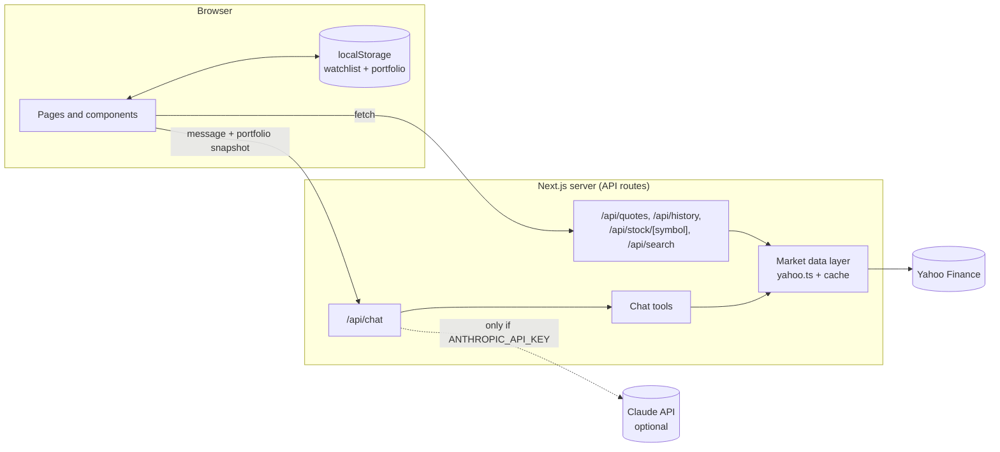
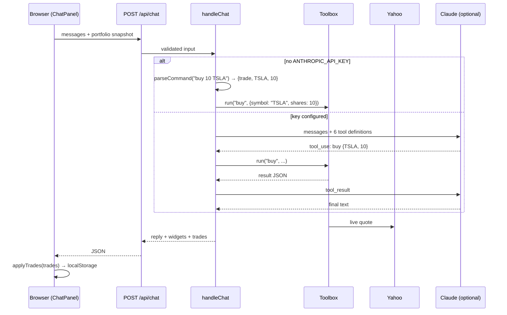

# Architecture

This document explains how AI Finance Assistant fits together, in plain language. It's written so you can walk someone through the code in an interview.

## The big picture

The app has three layers:

1. **The browser (React client components).** It shows pages, keeps the watchlist and the paper portfolio in `localStorage`, and calls our own API.
2. **Our server (Next.js API routes).** It talks to Yahoo Finance, and to Claude if a key is configured. The browser never talks to either of them directly.
3. **Outside services.** Yahoo Finance supplies market data and Anthropic supplies Claude. Claude is optional.



**Why the server sits in the middle:** `yahoo-finance2` can't run in a browser (Yahoo blocks cross-origin requests), and the Anthropic key must stay secret. A small server in between solves both problems, and it gives us one place to cache data and handle errors.

## Folder tour

| Path | What lives there |
| --- | --- |
| `src/lib/types.ts` | Our own small data shapes (`Quote`, `PricePoint`, `Range`…). The UI depends on these, never on Yahoo's raw format. |
| `src/lib/market/` | Everything about market data: the Yahoo wrapper, a tiny cache, ticker validation, and chart-range settings. |
| `src/lib/portfolio.ts` | The paper-trading engine, made of pure functions with no storage or network. |
| `src/lib/chat/` | The chat "brain": the tools, the command parser, the basic and Claude agents, and the function that picks a mode. |
| `src/lib/client/` | Browser-only helpers: the `localStorage` store, the watchlist and portfolio hooks, and a `fetch` wrapper. |
| `src/lib/server/` | Server-only helpers: reading the API key, JSON error responses, and rate limiting. |
| `src/app/` | Pages (`/`, `/stock/[symbol]`, `/portfolio`) and API routes (`/api/*`). |
| `src/components/` | React components, grouped by feature. |

## Layer 1: market data (`src/lib/market/`)

- **`yahoo.ts`** is the only file that imports `yahoo-finance2`. It does three jobs:
  1. **Translate** Yahoo's big responses into our small types. If Yahoo changes its format, only this file changes.
  2. **Cache** results briefly (`cache.ts`): quotes for 15 seconds, history and news for longer. Ten people loading the dashboard at once cause one Yahoo request, not ten. If two requests for the same thing arrive together, they share one in-flight promise. Failures are never cached.
  3. **Classify errors** into a `MarketDataError` with a code: `INVALID_SYMBOL` (400), `NOT_FOUND` (404) or `UNAVAILABLE` (503). Everything above this layer handles three well-defined cases instead of random exceptions.
- **`provider.ts`** defines a `MarketDataProvider` interface. The app uses the Yahoo implementation, and tests use a fake one. This is called *dependency injection*, and it's what makes the chat testable without the internet.
- **`ranges.ts`** maps 1D/1W/1M/1Y/5Y to Yahoo request settings. One trick: "1D" asks for five days of 5-minute bars and keeps only the last trading session, so the chart still has data on weekends.

## Layer 2: API routes (`src/app/api/`)

Each route is a thin wrapper. It validates the input, calls the market layer, and returns JSON. Errors always come back in the same shape:

```json
{ "error": { "code": "NOT_FOUND", "message": "Couldn't find a ticker called XYZZ." } }
```

| Route | Purpose |
| --- | --- |
| `GET /api/quotes?symbols=AAPL,MSFT&spark=1` | Quotes (and intraday sparkline points) for the watchlist. Unknown tickers are listed in `missing` instead of failing the request. |
| `GET /api/history?symbol=AAPL&range=1M` | Price points for charts. |
| `GET /api/stock/AAPL` | Quote and news for the detail page. News is best-effort. |
| `GET /api/search?q=apple` | Ticker suggestions. |
| `GET /api/ai-status` | `{ enabled: boolean }`, so the chat can show the AI on/off badge. |
| `POST /api/chat` | The chat endpoint (see below). |

## Layer 3: the browser

- **Pages are thin.** For example, `app/stock/[symbol]/page.tsx` is a server component that checks the ticker in the URL and then renders a client component (`StockView`) that does the fetching.
- **SWR** handles fetching. It caches responses, refreshes on a timer (every 30s for prices), retries failures, and keeps showing old data while new data loads.
- **`localStorage` stores** (`lib/client/local-store.ts`) wrap storage in an API that React's `useSyncExternalStore` understands. Any component that uses the portfolio re-renders when it changes, even if the change came from another tab. During server rendering they return a default value, because the server can't see your browser's storage.

## The paper-trading engine (`src/lib/portfolio.ts`)

A portfolio is a plain object:

```ts
{ version: 1, startingCash: 100000, cash, positions: { AAPL: { shares, costBasis } }, trades: [...], createdAt }
```

The key function is `executeTrade(portfolio, request)`. It returns either `{ ok: true, portfolio, trade }` with a **new** portfolio, or `{ ok: false, error }`. It never modifies the input. That makes it:

- **Easy to test.** Give it an input and check the output. There's no setup or mocking.
- **Safe to reuse anywhere.** The browser uses it for the buy and sell buttons, and the server uses the same function for chat trades.

Accounting rules:

- **Buy:** cash goes down by `shares × price` (rounded to cents), and the cost basis goes up by the same amount.
- **Sell:** you can't sell more than you own. A proportional slice of the cost basis is removed, and the difference is the *realized P&L*. This is the **average-cost method**.
- `summarizePortfolio` values holdings at live prices to get *unrealized P&L*. If a price is missing, it values that holding at cost and sets a flag instead of guessing.
- `computeValueSeries` draws the "value over time" chart. It walks through historical price bars from your first trade, replays the trades made up to each moment, and adds up `cash + shares × latest price`.

## The chat: how a message is answered



### The toolbox (`lib/chat/tools.ts`)

There are six functions: `get_quote`, `get_history`, `compare`, `buy`, `sell` and `get_portfolio`. Each one:

1. **Validates its input with Zod**, for example "shares must be a whole number greater than 0".
2. **Calls the market layer** for real data.
3. **Returns either `{ ok: true, data }` or `{ ok: false, error }`.** It never throws, so a bad ticker becomes a friendly sentence.
4. **Records a "widget"** (quote card, mini chart, comparison or trade card) for the UI to render.

Whichever mode is active, **numbers only enter the conversation through these tools**. That's the central idea behind "never invent prices".

### Basic mode (`parser.ts` + `basic-agent.ts`)

`parseCommand` uses regular expressions and a list of common English words to turn text into an *intent*, such as `{ type: "history", symbol: "MSFT", range: "1M" }`. Finding tickers in free text is the tricky part:

- `$TSLA` cash-tags and company names (`apple` → `AAPL`) are recognized first.
- Words typed in CAPITALS are treated as tickers (`how did NOW do` → ServiceNow).
- Lowercase words only count as tickers if the message looks finance-related, so "hello there" isn't read as ticker `THERE`.

`runBasicChat` calls the matching tool and fills in a sentence template with the returned numbers.

### AI mode (`claude-agent.ts`)

This is the standard **tool-use loop**:

1. Send Claude the conversation, a system prompt, and the six tool definitions (JSON Schemas with `strict: true`, so inputs always match the schema).
2. If Claude replies with `tool_use` blocks, run each one through the same toolbox and send all the results back in one message.
3. Repeat until Claude writes a normal text answer, or stop after 8 rounds as a safety cap.

The system prompt tells Claude to state only numbers that came from tool results, to keep answers short (the UI already draws charts from the tool calls), and to trade only when the user explicitly asks for a specific quantity. The loop also handles the `refusal` and `max_tokens` stop reasons. Default-model requests opt into Anthropic's server-side fallback (`fallbacks: "default"`), which retries on a backup model if a safety classifier declines.

**Fallback:** if the Claude call throws (wrong key, rate limit, network), `handleChat` answers the same message with basic mode and attaches a notice. The chat never just breaks.

### Why trades come back to the browser

The portfolio lives in the browser, but chat runs on the server. Each chat request includes a **snapshot** of the portfolio. The server runs trades against a private copy (so "buy 10 AAPL, then show my portfolio" works within one answer) and returns the list of trades. The browser then calls `applyTrades`, which re-runs `executeTrade` on its real portfolio. That call:

- **re-validates** each trade, in case the portfolio changed in another tab, and
- **skips trades it has already applied** by ID, so a retry can't double-buy.

## Security and safety notes

- **API key:** read only in `lib/server/ai-config.ts`, which imports `server-only`, so the build fails if client code ever imports it. `/api/ai-status` exposes a boolean only.
- **No HTML injection:** chat replies are rendered by a tiny Markdown-to-React renderer (`RichText.tsx`), not `dangerouslySetInnerHTML`.
- **Input limits:** chat messages are capped at 2,000 characters and the conversation history at 40 turns, and both are validated with Zod.
- **Rate limiting:** an in-memory per-IP limit (20 AI messages every 10 minutes, 60 basic messages a minute). On serverless hosts each instance counts separately, so this is a speed bump, not a guarantee.
- **Real money is impossible:** the only "trade" code is pure arithmetic on a JavaScript object.

## Testing

`npm test` runs Vitest:

| File | What it checks |
| --- | --- |
| `lib/portfolio.test.ts` | Buys, sells, average cost, P&L, error cases, immutability, value-series replay |
| `lib/chat/parser.test.ts` | About 30 example messages produce the expected intents |
| `lib/chat/tools.test.ts` | Tools return real provider data, friendly errors, and outage handling |
| `lib/chat/basic-agent.test.ts` | End-to-end basic replies contain the right numbers |
| `lib/chat/claude-agent.test.ts` | The Claude loop runs against a **scripted fake client**: tool calls are executed, results are sent back, and refusals, round caps and the fallback to basic mode all work. The real API is never called. |
| `lib/market/*.test.ts` | Symbol parsing, range logic, the cache |

## Questions you might be asked

- **"Where does the data come from, and what if it's down?"** Yahoo Finance via `yahoo-finance2`, on the server only. Failures become a `MarketDataError` with a code, and the UI shows a retry notice instead of crashing. Cached data keeps showing if a refresh fails.
- **"How do you stop the AI from hallucinating prices?"** It has no way to get a price except by calling our tools, and the system prompt forbids numbers that don't come from tool results. The charts are drawn from tool data, not from the model's text.
- **"Why `localStorage` instead of a database?"** It needs no accounts or backend state, and it deploys free. For real users I'd add authentication and a database such as Postgres, keyed by user ID, and keep `executeTrade` exactly as it is.
- **"What would you improve?"** Limit orders, dividends and splits in the value history, streaming chat responses, a shared cache like Redis for multiple server instances, and end-to-end tests with mocked market data.
